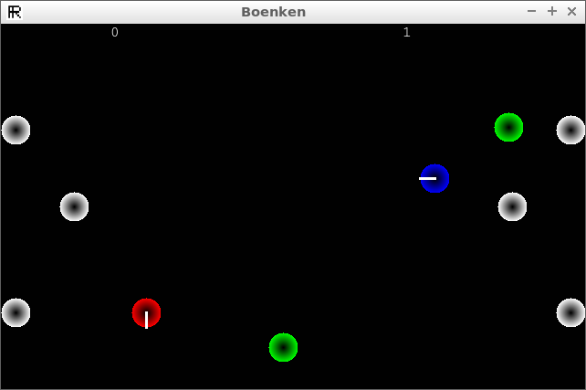
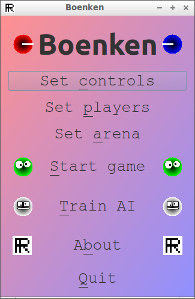
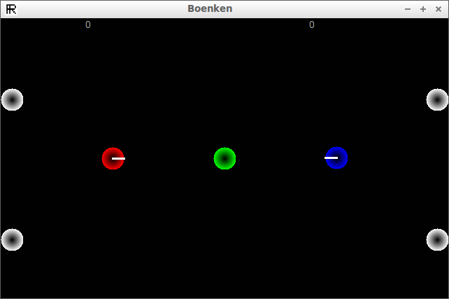
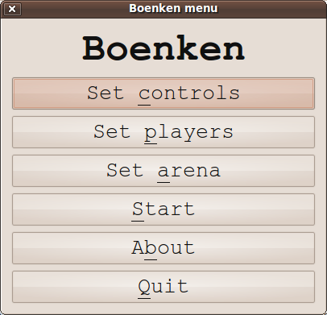
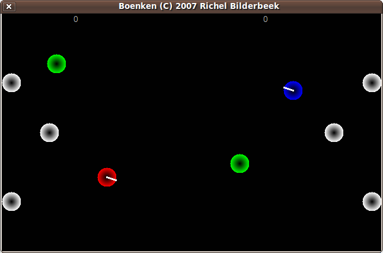
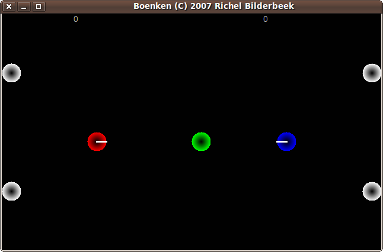
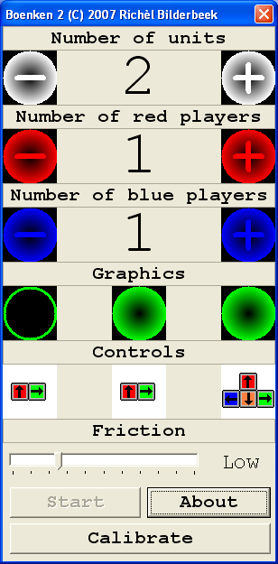
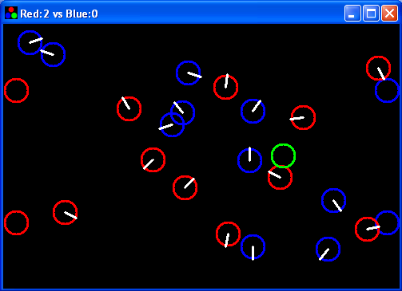
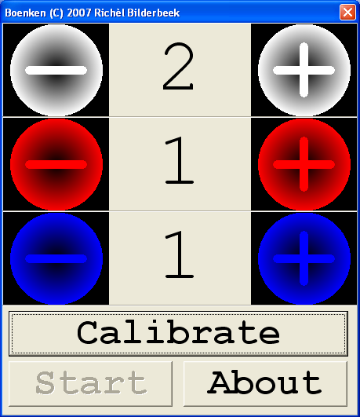
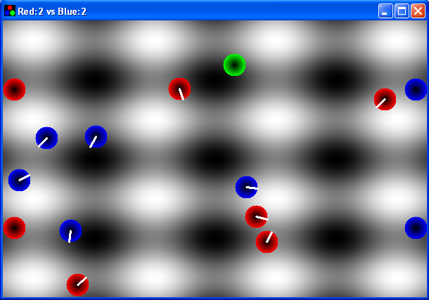

# Boenken

[Go to the nicely rendered website](https://richelbilderbeek.github.io/Boenken/),
where you can also play the game in your browser.

Boenken is a two-player game that is a mix between soccer and billiards,
programmed in C++ using Qt.

## Build

Boenken needs Qt 6:

```bash
qmake Boenken.pro
make
```

To build the WebAssembly version, do the same with the `qmake` of
Qt for WebAssembly and the matching version of Emscripten.
[build_game.yaml](.github/workflows/build_game.yaml)
shows which versions are used and builds the Linux, Windows and WebAssembly versions.
[create_zensical_website.yaml](.github/workflows/create_zensical_website.yaml)
puts the WebAssembly and Windows versions on the website.

## I want to contribute!

Awesome!

You can collaborate by

 * add a GitHub issue: this can be a question, suggestion, or whatever
 * fork this repository, make the changes, and submit a pull request.

# Screenshot archive

Most recent at the top.

















## External links

 * [Richel Bilderbeek's games](https://github.com/richelbilderbeek/Games)
