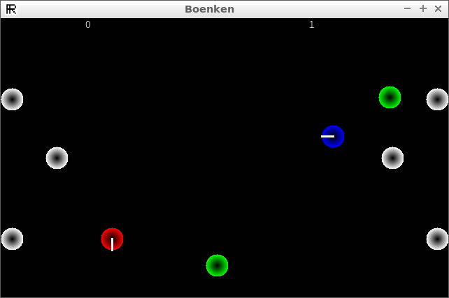
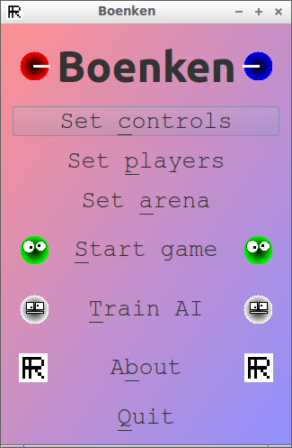

# Boenken

Boenken is a two-player game that is a mix between soccer and billiards,
and one of [Richèl Bilderbeek's games](https://richelbilderbeek.github.io/games)

- [Play Boenken in your browser](play.md)
- [Download the Windows version](https://richelbilderbeek.github.io/Boenken/boenken_windows.zip):
  unzip it and run `boenken.exe`

## How to play

Each player controls a ball and tries to push the green ball
into the goal of the other player.
A player can only accelerate and turn right:

Player |Accelerate|Turn right
-------|----------|----------
Red    |W         |D
Blue   |Up        |Right

The keys can be changed in the 'Set controls' menu.
Press Escape to go back to the menu.

